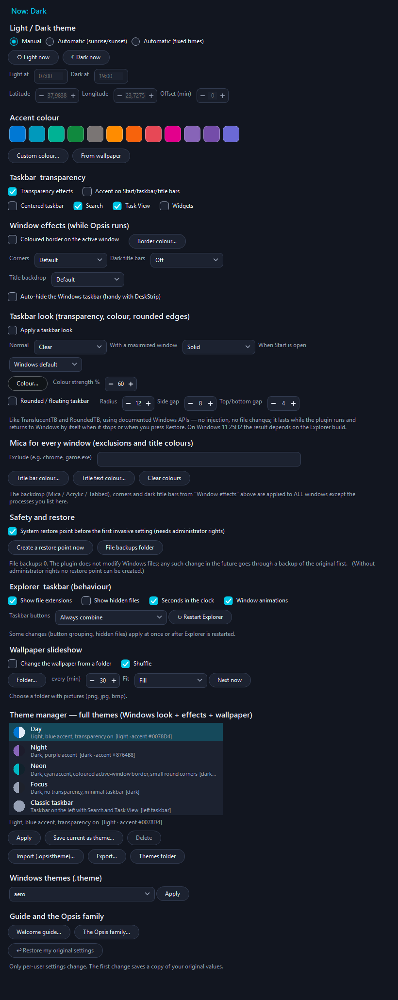
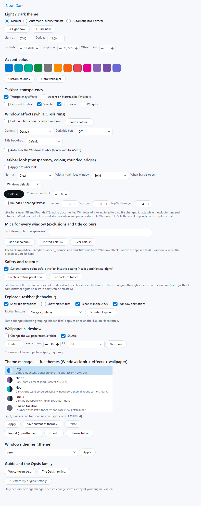
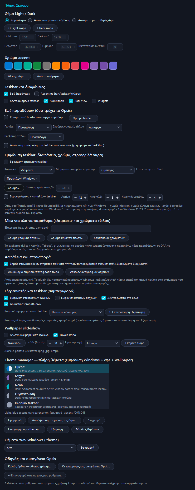
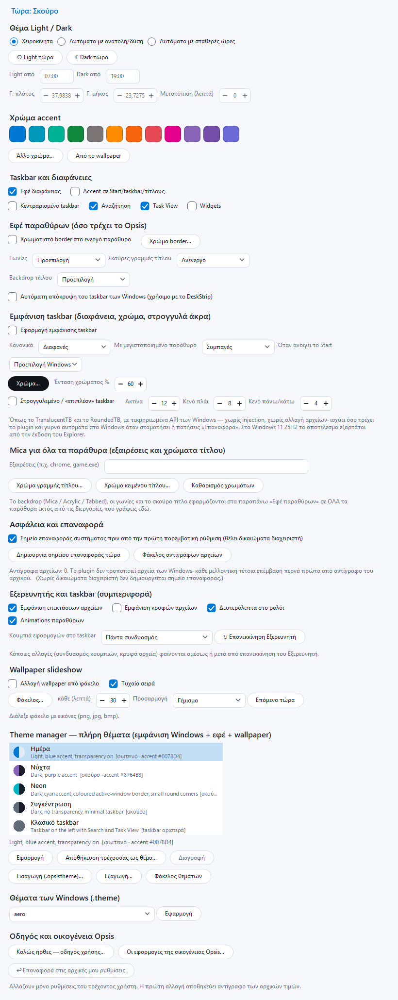
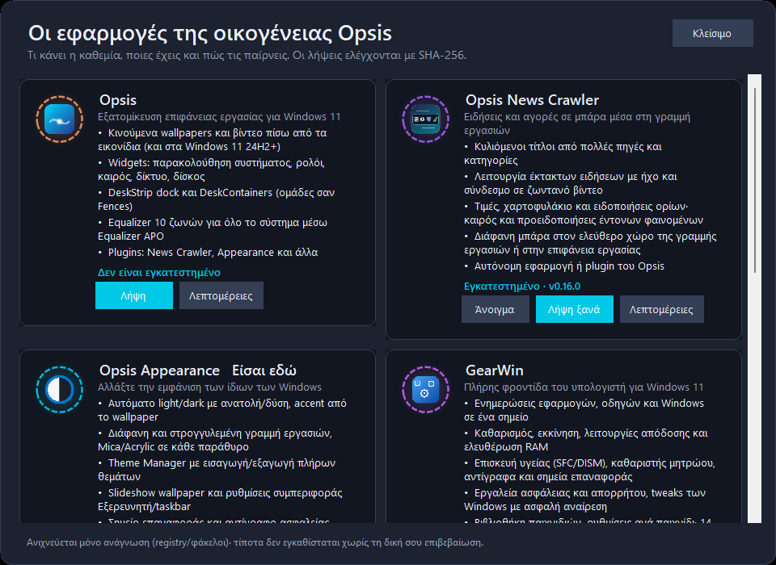
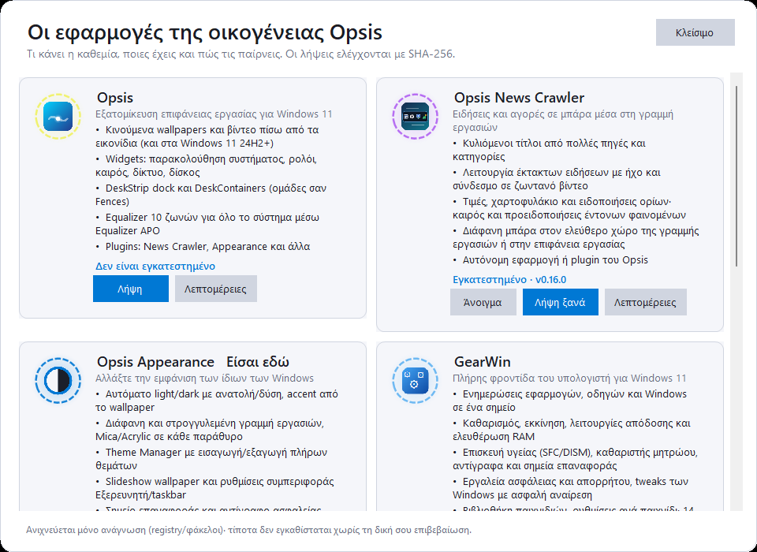

# Opsis Appearance

<p align="center">
  
</p>

<p align="center">
  <strong>Άλλαξε την εμφάνιση των ίδιων των Windows 11 — ως plugin του Opsis ή ως αυτόνομη εφαρμογή.</strong><br/>
  <strong>Change the look of Windows 11 itself — as an Opsis plugin or as a stand-alone app.</strong>
</p>

<p align="center">
  
  
  
  
</p>

*English below / Αγγλικά παρακάτω.*

## Ελληνικά

Το **Opsis Appearance** αλλάζει την εμφάνιση του περιβάλλοντος των Windows με τεκμηριωμένα API (registry του τρέχοντος χρήστη και DWM) — **χωρίς injection, χωρίς drivers, χωρίς δικαιώματα διαχειριστή**.

| Λειτουργία | Τι κάνει |
|---|---|
| ☀ / ☾ Αυτόματο θέμα | Light/Dark με **ανατολή/δύση** (υπολογίζεται από γεωγραφικό πλάτος/μήκος· προεπιλογή Αθήνα) ή σταθερές ώρες, με μετατόπιση λεπτών |
| 🎨 Accent | 12 έτοιμα χρώματα, δικό σου χρώμα, ή **χρώμα από το wallpaper** (κυρίαρχο χρώμα της εικόνας) |
| 🧱 Taskbar | Στοίχιση αριστερά/κέντρο, Αναζήτηση, Task View, Widgets, διαφάνειες, accent σε Start/taskbar/τίτλους |
| 🪟 Εφέ παραθύρων | Χρωματιστό **border στο ενεργό παράθυρο**, **γωνίες** (στρογγυλές/μικρές/τετράγωνες), **σκούρες γραμμές τίτλου**, backdrop **Mica / Acrylic / Tabbed**, αυτόματη απόκρυψη taskbar |
| 👋 Καλωσόρισμα και οικογένεια Opsis | Οδηγός χρήσης 6 σελίδων στην πρώτη εκκίνηση κάθε νέας έκδοσης (αυτόνομη εφαρμογή), κάρτες όλων των εφαρμογών της οικογένειας με Άνοιγμα / Λήψη με έλεγχο SHA-256, και balloon νέας έκδοσης στο tray. Μέσα στο Opsis υπάρχουν μόνο οι εγγραφές μενού/σελίδας (όχι δεύτερο splash) |
| 🫧 Εμφάνιση taskbar (στο πνεύμα του TranslucentTB) | Διαφανές / blur / acrylic / συμπαγές με χρώμα και ένταση, **διαφορετική κατάσταση όταν υπάρχει μεγιστοποιημένο παράθυρο ή ανοίγει το Start**, κάθε οθόνη. Χωρίς injection |
| ⭕ Στρογγυλό / «επιπλέον» taskbar (στο πνεύμα του RoundedTB) | Ακτίνα και κενά γύρω-γύρω με περιοχή κοπής (`SetWindowRgn`), αυτόματη επανεφαρμογή όταν αλλάζει το μέγεθος |
| 🪟 Mica για όλα τα παράθυρα (στο πνεύμα του Mica For Everyone) | Backdrop Mica/Acrylic/Tabbed, γωνίες, σκούρος τίτλος **και χρώμα γραμμής/κειμένου τίτλου**, με **λίστα εξαιρέσεων** ανά διεργασία |
| 🛟 Ασφάλεια | **Σημείο επαναφοράς συστήματος** πριν από την πρώτη παρεμβατική ρύθμιση (θέλει διαχειριστή), **BackupVault** με SHA-256 για το αρχικό κάθε αρχείου πριν από οποιαδήποτε επέμβαση σε αρχείο, επαναφορά με ένα κουμπί |
| 📁 Εξερευνητής και taskbar | Επεκτάσεις αρχείων, κρυφά αρχεία, δευτερόλεπτα στο ρολόι, animations παραθύρων, συνδυασμός κουμπιών στο taskbar (πάντα / όταν γεμίσει / ποτέ με ετικέτες), επανεκκίνηση του Εξερευνητή με ένα κουμπί |
| 🖼 Wallpaper slideshow | Αλλάζει το wallpaper από φάκελο κάθε N λεπτά (τυχαία ή με σειρά, όλοι οι τρόποι προσαρμογής), «Επόμενο τώρα», και επαναφορά του αρχικού wallpaper όταν το σβήσεις |
| 🗂 Theme Manager | **Πλήρη θέματα** (εμφάνιση + εφέ + wallpaper): εφαρμογή με ένα κλικ, αποθήκευση του τρέχοντος ως θέμα, **εισαγωγή/εξαγωγή `.opsistheme`**, καθώς και λίστα των `.theme` των Windows |
| ↩ Επαναφορά | Την πρώτη αλλαγή αποθηκεύεται αντίγραφο των αρχικών τιμών· το κουμπί «Επαναφορά» τις γυρνά όλες πίσω. Τα εφέ παραθύρων επαναφέρονται πλήρως όταν σταματά η εφαρμογή |

**Ελαφρύ για αδύναμα PC:** κανένα background thread, κανένα polling. Ένας timer 60 δευτ. μόνο όσο είναι ενεργό αυτόματο θέμα· τα εφέ παραθύρων χρησιμοποιούν ειδοποιήσεις των Windows (`SetWinEventHook`) και όχι έλεγχο σε βρόχο.

### Ιδιωτικότητα — τι επικοινωνεί με το διαδίκτυο (αυτόνομη εφαρμογή)

- **Έλεγχος νέας έκδοσης** (Μενού tray → «Ειδοποίηση για νέες εκδόσεις», ενεργός από προεπιλογή): 30″ μετά την εκκίνηση και μετά κάθε 24 ώρες ένα `GET` στο `api.github.com/repos/giorstergiopoulos-design/OpsisAppearance/releases/latest` (ETag, timeout 8″). Τίποτα άλλο δεν στέλνεται. Μία ειδοποίηση ανά έκδοση.
- **Κατάλογος εφαρμογών** (παράθυρο «Οι εφαρμογές της οικογένειας Opsis»): το πολύ μία λήψη την ημέρα του `suite/apps.json` από το GitHub (έγκυρο μόνο από github.com, ≤256 KB, με έλεγχο)· αλλιώς το ενσωματωμένο αντίγραφο. Η ανίχνευση «εγκατεστημένο» διαβάζει μόνο registry/φακέλους. Λήψεις μόνο μετά από επιβεβαίωση και με έλεγχο SHA-256 (άρνηση σε ασυμφωνία)· τίποτα δεν εκτελείται αυτόματα.
- Μέσα στο Opsis (plugin) δεν γίνεται κανένας αυτόματος έλεγχος ή balloon από το plugin.

### Τι ΔΕΝ περιλαμβάνεται (και γιατί)

- **Windhawk και ExplorerBlurMica**: λειτουργούν με **injection DLL μέσα στο `explorer.exe`** / hooks σε αρχεία του συστήματος. Αυτό δεν υλοποιείται εδώ: ένα λάθος διακόπτει τον Explorer, τα antivirus το μπλοκάρουν και κάθε αναβάθμιση των Windows το χαλάει. Αν θέλεις τέτοια mods, χρησιμοποίησε το ίδιο το Windhawk — η επαναφορά του plugin (σημείο επαναφοράς, `BackupVault`) είναι έτοιμη να καλύψει μελλοντική επέμβαση σε αρχείο.
- **TaskbarX**: τα Windows 11 έχουν ήδη κεντραρισμένο taskbar (υπάρχει διακόπτης «Κεντραρισμένο taskbar»)· οι κινούμενες μετατοπίσεις εικονιδίων του TaskbarX δεν υλοποιούνται.
- Δεν υπάρχει πλήρης ισοδυναμία με τα παραπάνω προγράμματα· υλοποιούνται μόνο όσα αναφέρονται στον πίνακα.

### Στιγμιότυπα / Screenshots

| Σκούρο / Dark | Φωτεινό / Light |
|---|---|
|  |  |
|  |  |
|  |  |

*(Πραγματικά παράθυρα αυτής της έκδοσης: `OpsisAppearance.exe --snapshot` και `--family-snapshot`. / Real windows of this build.)*

### Ασφάλεια / Security

Μοντέλο εμπιστοσύνης, έλεγχος και ανοιχτά θέματα: [SECURITY.md](SECURITY.md). Επαλήθευση λήψης: `Get-FileHash .\OpsisAppearance-Setup.exe -Algorithm SHA256` και σύγκριση με το `.sha256` του release. / Trust model, review results and open items: [SECURITY.md](SECURITY.md); verify downloads by comparing SHA-256 with the `.sha256` file of the release.

### Εγκατάσταση

Κατέβασε από τα [Releases](../../releases/latest):

| Αρχείο | Τι είναι |
|---|---|
| `OpsisAppearance-Setup.exe` | Installer — επιλέγεις **«Ως plugin του Opsis»** ή **«Αυτόνομη εφαρμογή»** (προτείνει το plugin αν βρει το Opsis). Χωρίς admin |
| `OpsisAppearance-Standalone-<έκδοση>.zip` | Αυτόνομη εφαρμογή, χωρίς εγκατάσταση (θέλει .NET 10 Desktop Runtime) |
| `OpsisAppearance-Plugin-<έκδοση>.zip` | Μόνο το plugin: αντίγραψε τον φάκελο `Opsis Appearance` στο `%AppData%\Opsis\plugins\` και κάνε επανεκκίνηση του Opsis |

Ο installer του **Opsis** (2.1.1+) προσφέρει επίσης επιλογή «Λήψη και εγκατάσταση του Opsis Appearance» και το εγκαθιστά ως plugin.

Σιωπηλή εγκατάσταση: `OpsisAppearance-Setup.exe /VERYSILENT /MODE=plugin` ή `/MODE=standalone`.

### Ασφάλεια των θεμάτων `.opsistheme`

Ένα `.opsistheme` είναι zip με **μόνο** `theme.json` και προαιρετικά `wallpaper.png|jpg|bmp` (έως 40 MB). Η εισαγωγή απορρίπτει οποιοδήποτε άλλο αρχείο (διαδρομές, `.exe`, `.dll`), μετράει τα πραγματικά bytes (όχι το μέγεθος του header), και καθαρίζει όλες τις τιμές. Δεν εκτελείται κώδικας.

### Χτίσιμο

```powershell
powershell -File build.ps1          # δοκιμές + standalone + plugin + zips + installer (Inno Setup 7)
dotnet test OpsisAppearance.sln     # 220 unit tests
```

Απαιτείται: Windows 11, [.NET 10 SDK](https://dotnet.microsoft.com/download), [Inno Setup 7](https://jrsoftware.org/isdl.php).

### Δομή

```
src/OpsisAppearance.Plugin   η μηχανή + η σελίδα (το DLL που φορτώνει το Opsis)
src/OpsisAppearance.App      η αυτόνομη εφαρμογή (tray + παράθυρο, ίδια σελίδα)
tests/                       unit tests (ψεύτικο registry/παράθυρα/wallpaper — δεν αγγίζουν τις ρυθμίσεις σου)
installer/                   Inno Setup 7 (Opsis plugin ή αυτόνομο)
libs/                        το κοινό συμβόλαιο plugin του Opsis
```

## English

**Opsis Appearance** changes the look of the Windows environment through documented APIs (per-user registry and DWM) — **no injection, no drivers, no administrator rights**.

| Feature | What it does |
|---|---|
| ☀ / ☾ Automatic theme | Light/Dark at **sunrise/sunset** (computed from latitude/longitude, Athens by default) or fixed times, with a minute offset |
| 🎨 Accent | 12 presets, your own colour, or the **colour of your wallpaper** (dominant colour of the image) |
| 🧱 Taskbar | Left/centre alignment, Search, Task View, Widgets, transparency, accent on Start/taskbar/title bars |
| 🪟 Window effects | Coloured **border on the active window**, **corners** (round/small/square), **dark title bars**, **Mica / Acrylic / Tabbed** backdrop, taskbar auto-hide |
| 🗂 Theme Manager | **Full themes** (look + effects + wallpaper): one-click apply, save the current look as a theme, **import/export `.opsistheme`**, plus a list of the Windows `.theme` files |
| ↩ Restore | The first change saves a copy of your original values; "Restore" puts them all back. Window effects are fully undone when the app stops |

**Light on weak PCs:** no background threads, no polling. One 60 s timer only while an automatic schedule is on; the window effects use Windows notifications (`SetWinEventHook`), not a polling loop.

### Install

Download from [Releases](../../releases/latest):

| File | What it is |
|---|---|
| `OpsisAppearance-Setup.exe` | Installer — choose **"As a plugin of Opsis"** or **"Stand-alone app"** (it proposes the plugin when it finds Opsis). No admin needed |
| `OpsisAppearance-Standalone-<version>.zip` | The stand-alone app, no installation (needs the .NET 10 Desktop Runtime) |
| `OpsisAppearance-Plugin-<version>.zip` | The plugin only: copy the `Opsis Appearance` folder to `%AppData%\Opsis\plugins\` and restart Opsis |

The **Opsis** installer (2.1.1+) also offers "Download and install Opsis Appearance" and installs it as a plugin.

Silent install: `OpsisAppearance-Setup.exe /VERYSILENT /MODE=plugin` or `/MODE=standalone`.

### Safety of `.opsistheme` packages

A `.opsistheme` is a zip with **only** `theme.json` and an optional `wallpaper.png|jpg|bmp` (up to 40 MB). Import rejects any other file (paths, `.exe`, `.dll`), counts the real bytes (not the size claimed in the header) and sanitises every value. Nothing is executed.

### Build

```powershell
powershell -File build.ps1          # tests + stand-alone + plugin + zips + installer (Inno Setup 7)
dotnet test OpsisAppearance.sln     # 72 unit tests
```

Requires Windows 11, the [.NET 10 SDK](https://dotnet.microsoft.com/download) and [Inno Setup 7](https://jrsoftware.org/isdl.php).

## Άδεια / License

MIT — see [LICENSE](LICENSE). Part of the Opsis family: [Opsis](https://github.com/giorstergiopoulos-design/Opsis) · [Opsis News Crawler](https://github.com/giorstergiopoulos-design/OpsisNewsCrawler) · [Waveframe](https://github.com/giorstergiopoulos-design/waveframe).
